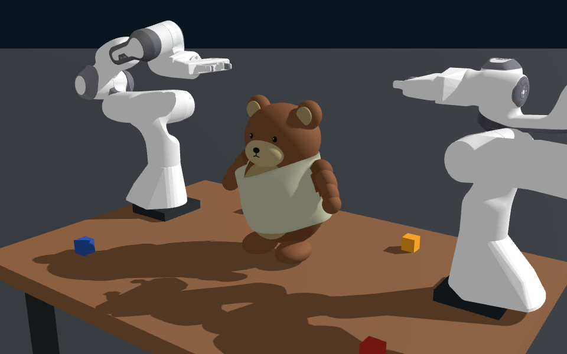

# Genesis Teddy Dressing Prototype

根据同一初始状态的四张图像，在 Genesis 中重建双臂给熊穿衣的**理想化运动学原型**：衣片包住腹部，双臂穿过两个真实袖孔，两端代理魔术贴闭合后松手。

没有读取原仿真的模型、物性、控制器或运行数据。熊、衣片与场景由代码生成；机器人使用 Genesis 上游 Panda 资产。



[完整演示视频](outputs/final/simulation.mp4) · [袖口与背部细节](outputs/final/details.mp4) · [详细建模与运行说明](README_zh.md)

## 这个原型能说明什么

布料由 **Genesis 原生 PBD** 实际求解，没有逐帧指定布料形状。最终示例中，双臂穿袖、腹部包裹和松手保持 17 秒通过了保存状态的几何与布料代理检查。

**它尚不具备 sim-to-real 控制基础。** 机械臂每步通过 `set_qpos()` 直接设置关节姿态，存在逆运动学解跳变：约 8.1 s 和 15.3 s 处，单关节分别变化约 165° / 20 ms 与 167° / 20 ms。机器人碰撞关闭；抓持是理想单点附着；黏合是永久代理约束，未模拟真实夹持滑脱或魔术贴剥离。

[验证报告](outputs/final/validation.json) 中的 `task_success=true` **只表示布料与几何代理检查通过，不代表机械臂动作可执行或真机任务成功**。完整限制和改进前提见[详细说明](README_zh.md#已知机械臂控制问题)。

## 运行

使用已安装 Genesis 1.4.3 的 Python 环境；默认使用 CPU，下面显式选择 GPU：

```bash
./run.sh --backend gpu --duration 31 --render-every 2 --sample-every 1 --detail-video --output outputs/my_run
```

可用 `GENESIS_PYTHON` 指定环境中的解释器。代码依赖 Genesis 私有求解器接口，其他版本需要重新检查兼容性。更多参数、物性假设及输出格式见 [README_zh.md](README_zh.md)。

仓库包含代码、生成资产、最终视频、截图和小型报告。约 60.7 MiB 的完整 `trajectory.npz` 不纳入常规 Git 历史，可从 [v0.1.0 Release](https://github.com/Chloe-Jinlei/genesis-teddy-dressing/releases/tag/v0.1.0) 下载并放回 `outputs/final/trajectory.npz`；也可以运行上面的命令重新生成。文件大小和 SHA-256 见 [release_asset.json](release_asset.json)，记录环境版本见 [environment.json](environment.json)。
