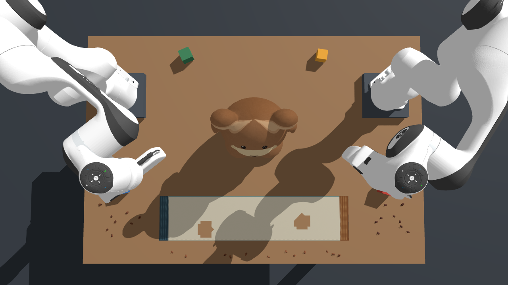
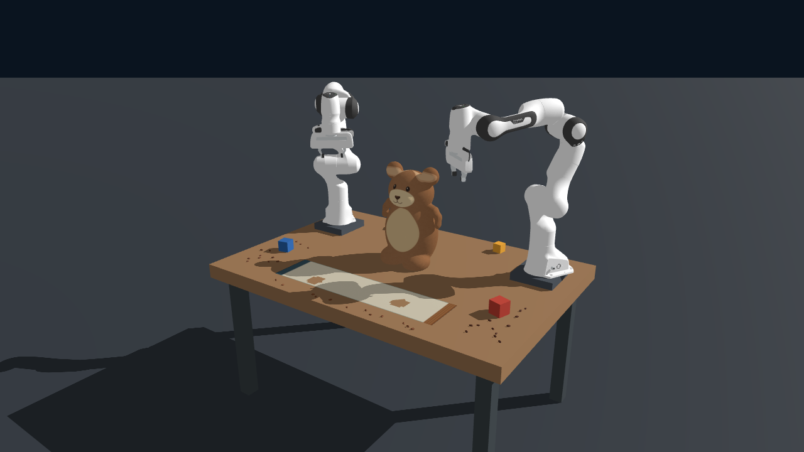
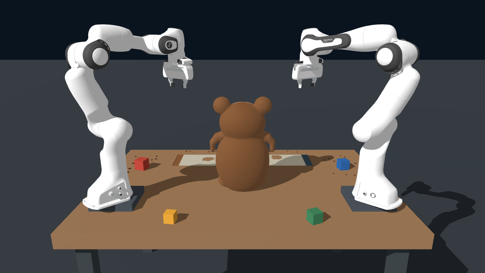
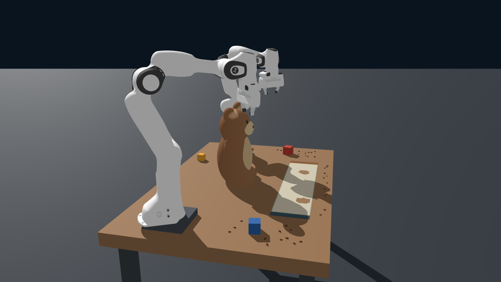

# 原始输入图片

以下四张图片是用户提供的同一初始状态的不同视角，顺序与原请求一致。文件按原始字节保存，未经裁剪、压缩或编辑。

原始文件名、仓库路径和 SHA-256 见 [input_provenance.json](../../input_provenance.json)。重建后的初始截图位于 `outputs/final/initial_*.png`，与本目录的输入原图不同。

## 图片 1

Codex Image Oct 23, 2026, 06_19_27 PM.png

## 图片 2

Codex Image Oct 23, 2026, 06_19_36 PM.png

## 图片 3

Codex Image Oct 23, 2026, 06_19_49 PM.png

## 图片 4

Codex Image Oct 24, 2026, 12_59_25 PM.png

